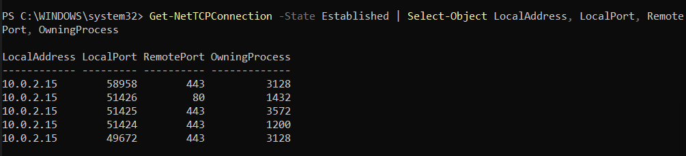
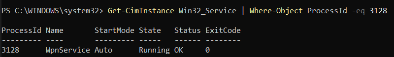
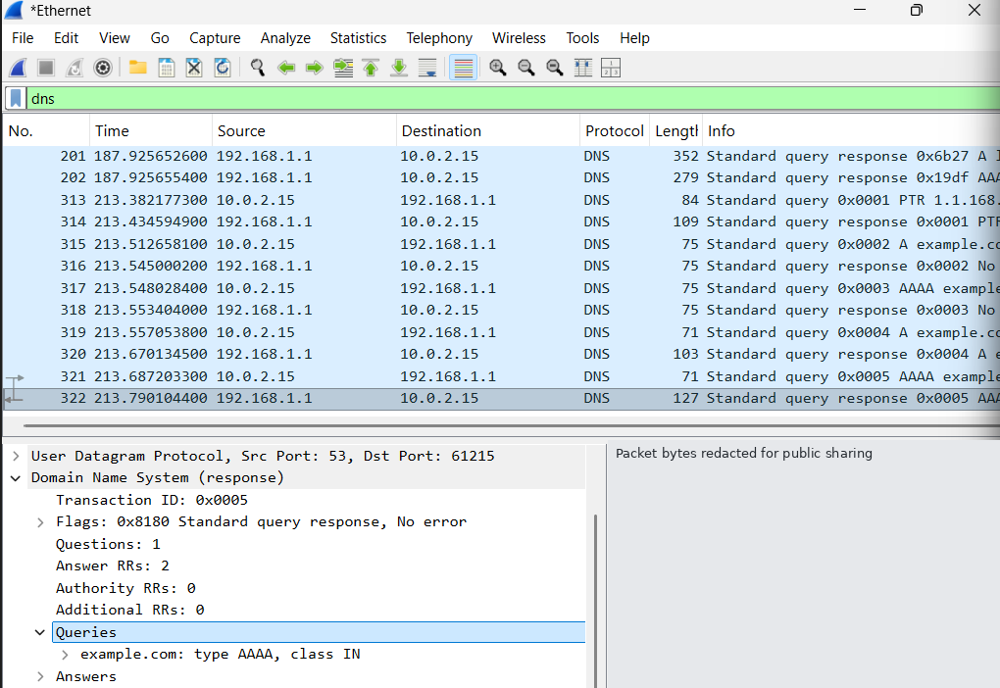
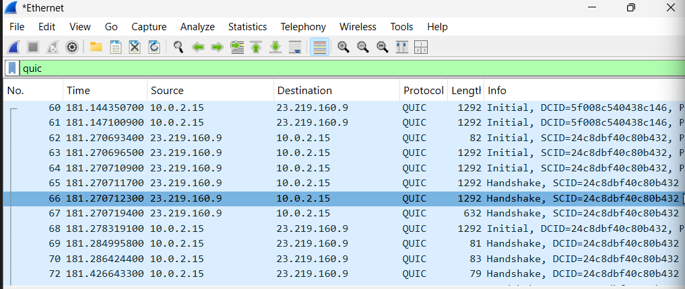
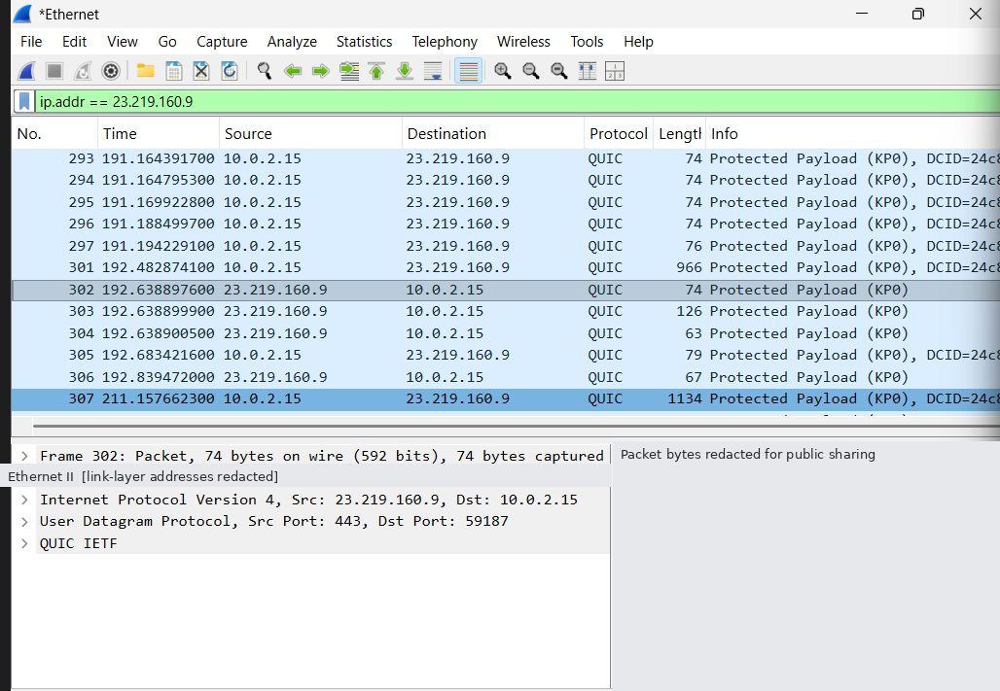

# Network Fundamentals & Wireshark Traffic Analysis

**Project 02 · Cybersecurity portfolio · Hands-on Windows 11 lab**

## Overview

This project documents 16 guided networking exercises in an authorized **Windows 11 VirtualBox virtual machine**. I practiced network troubleshooting, investigated TCP connections and their associated processes, captured packets in Wireshark, and performed a basic evidence-based network traffic assessment.

**Tools:** Windows PowerShell, `ipconfig`, `ping`, `nslookup`, `tracert`, `netstat`, Windows CIM commands, Wireshark 4.6.9, Npcap, VirtualBox.

**Scope:** Lab VM's own network traffic only. This is a learning investigation, **not** a confirmed security incident or production engagement.

## What I practiced

| Area | Exercises | Skills |
| --- | --- | --- |
| Network configuration | 1–2 | IPv4, subnet mask, gateway, DNS, DHCP, MAC address |
| Connectivity | 3–6 | Gateway/external ping, DNS resolution, traceroute |
| TCP/process investigation | 7–12 | TCP/UDP endpoints, remote ports, PID-to-process-to-service correlation, reverse DNS |
| Packet capture | 13–14 | Interface selection, Wireshark/Npcap, TCP packets |
| Protocol filtering | 15 | TCP, UDP, DNS filters; A/AAAA/PTR records and query-response pairing |
| Mini-investigation | 16 | IPv4 address filter, QUIC handshake/protected payload observations, evidence-based assessment |

## Selected findings

### Windows networking

- The VM used private IPv4 address **`10.0.2.15`** with subnet mask **`255.255.255.0`** and default gateway **`10.0.2.2`**.
- The VM successfully pinged its gateway and **`1.1.1.1`** in the recorded tests (four replies each, zero packet loss). This showed ICMP reachability at the times tested, not general assurance that all network services worked.
- A traceroute to `1.1.1.1` showed the first hop at `10.0.2.2`; later hops timed out. This alone does not establish that the destination was unreachable, since ping had succeeded.
- A reverse lookup for `104.208.203.88` returned **Non-existent domain**. Missing reverse DNS does not mean an IP is unreachable or malicious.

### TCP connections, process and service

- A snapshot of established TCP connections showed external endpoints using destination ports **443** and **80**.
- In a subsequent PowerShell connection snapshot, **PID `3128`** appeared on two established TCP entries.
- `Get-Process -Id 3128` returned **`svchost`**; querying `Win32_Service` for that PID returned **`WpnService` (Running)**. This links the observed process ID to a Windows service at the time investigated; it does not by itself prove the traffic was benign.

### Wireshark and DNS

- Confirmed **Ethernet** was the capture interface associated with `10.0.2.15`.
- Captured a small TCP exchange containing **ACK** packets; a later TCP-filtered capture showed **FIN, ACK** followed by **ACK**.
- Practiced `tcp`, `udp`, and `dns` **display filters**. An empty filter result was treated as no matching packets *in that capture*, not proof that the protocol was absent from the network.
- Ran `nslookup example.com` while capturing. Wireshark showed traditional DNS queries/responses between the VM and its configured DNS resolver `192.168.1.1`, including A and AAAA requests. One selected response showed transaction ID **`0x0005`**, **no error**, and **two answer records** for an AAAA query.

### External QUIC investigation

The selected external endpoint was **`23.219.160.9`**. The capture showed two-way QUIC communication between it and the lab VM. Wireshark identified **Initial**, **Handshake**, and later **Protected Payload** packets.

A selected packet (**No. 302**) showed:

| Field | Observed value |
| --- | --- |
| Source → destination | `23.219.160.9` → `10.0.2.15` |
| Transport | UDP / QUIC |
| Source → destination port | `443` → `59187` |
| Frame length | 74 bytes |
| Wireshark description | Protected Payload |

## Assessment

**Finding:** Encrypted QUIC communication with an external IPv4 address was observed.

**Disposition:** **Undetermined / no malicious activity established by the captured evidence.** QUIC over UDP/443 is common in legitimate applications, but the protocol alone does not identify the process or prove safety. The visible screenshots do **not** establish which application initiated the connection, which service was contacted, or the content of the encrypted data.

**Suggested follow-up:** Correlate the IP/port and capture timestamp with live process information and appropriate host logs; identify the application and verify whether the destination and behavior are expected. Process IDs may change between observations.

## Reproduce the learning steps

See [Commands and Filters](COMMANDS-AND-FILTERS.md) for the exact commands and filters used in this training project. All packet captures were collected from a lab machine I controlled.

## Evidence index

Screenshots in [`screenshots/`](screenshots/) cover exercises **9–16**, including the Wireshark installation checks, TCP/UDP/DNS filters, DNS lookups, and final QUIC investigation. Earlier exercises are summarized from the lab observations but **do not have corresponding screenshots in this publication package**.

### Public-sharing privacy measures

- Lab account names, VM computer labels, IPv6 interface identifiers, visible link-layer MAC addresses, and packet-hexadecimal views have been obscured in the screenshots where applicable.
- RFC 1918 lab IPv4 addresses (`10.0.2.15`, `192.168.1.1`, `10.0.2.2`) remain because they illustrate the packet flows and are not internet-routable host identifiers.
- Remote/public destination IP addresses remain for the reproducibility of the security investigation; they are **not asserted to be the user's own public IP**.
- Raw `.pcap`/`.pcapng` files were intentionally excluded. Screenshots are edited public versions, not unmodified forensic originals. Keep the original evidence private.
- Before publishing any new screenshots or packet captures, recheck for credentials, account names, public-facing home IPs, Wi-Fi information, addresses, MACs, IPv6 identifiers, and capture payloads.

## Lessons learned

1. Network connections are evidence, not verdicts: ports, IPs, and process names require context.
2. A Wireshark display filter hides nonmatching packets without deleting them.
3. DNS resolution, connection establishment, and actual website use are different events.
4. QUIC can reveal useful metadata even when its application payload is encrypted.
5. A responsible investigation documents limitations and avoids labeling traffic malicious without support.
